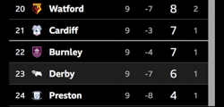

# Draft: Derby County 1-1 Wrexham

- **Published:** not yet — second-pass draft against the `patreon-match-post`
  format. Lineup, subs, bookings, attendance, formation and table are now
  confirmed against Si's BBC and table screenshots; the first pass (web
  snippets only) had the sub pairings wrong, now corrected.
- **Fixture:** EFL Championship, Matchday 9, Pride Park, Saturday 10 October
  2026, KO 15:00 — Derby home.
- **Still open:** The Read is drafted but What's Next, fan quotes, podcast
  link and player commentary need Si — see the end of this file.

---

## Title field

```
Derby 1-1 Wrexham: Szmodics scores early, we dominate, and still no home win
```

## Public preview (above the paywall)

```
Sam Szmodics had Derby ahead inside ten minutes at Pride Park.

For most of the afternoon the Rams were the better side, with Szmodics himself close to a second more than once.

Then Ollie Rathbone popped up with two minutes left to make sure the home win we're still waiting for stays on hold.

Full breakdown for patrons below 👇
```

## Patrons-only body (below the paywall)

```
## The Match

EFL Championship, Matchday 9
Derby County vs Wrexham
Saturday 10 October 2026, KO 15:00
Pride Park, Derby


## Starting XI Rams

⚪ #31 — Josh Vickers
⚪ #23 — Joe Ward
⚪ #28 — Dion Sanderson
⚪ #6 — Sondre Langås
⚪ #26 — Ryan Hedges
⚪ #20 — Alex Mowatt
⚪ #4 — David Ozoh
⚪ #16 — Mohammed Fuseini
⚪ #8 — Bobby Clark
⚪ #11 — Sam Szmodics
⚪ #9 — Carlton Morris (c)

(4-2-3-1)


## Subs

**72'** Szmodics ↓ · ↑ Brewster
**72'** Fuseini ↓ · ↑ Meister
**84'** Clark ↓ · ↑ Fraulo
**84'** Morris ↓ · ↑ Salvesen


## The People, Not Just the Sheet

### Sam Szmodics
Fifth goal of the season inside ten minutes, and then, by the club's own account, a series of chances to make it two. One goal, a lot of near-misses, and a draw that should have been a win — the man did his bit and the afternoon still finished level. Off for Brewster at 72'.

### Mohammed Fuseini
The assist for Szmodics's opener at 9', and 72 minutes on the pitch before making way for Meister. [Add a line once there's a view on how the rest of his afternoon went.]

### Sondre Langås
Booked after five minutes. Five. [Add a line on how he coped for the other 85 — nothing in the sources to say either way.]

### Ryan Hedges
Booked at 52', but stayed on for the full 90.

### Alex Mowatt
Yellow card at 74'. [Placeholder — add a view on his afternoon.]

### Carlton Morris
Armband, 84 minutes up front, no goal. [Placeholder — needs a view on his afternoon.]

### The late subs
Brewster and Meister on at 72', Fraulo and Salvesen at 84'. Wrexham equalised at 88', four minutes after the second pair of changes. Worth a line on whether that's coincidence or the game getting loose — Si's call.


## Stats Snapshot

Goals: 9' Szmodics (assist Fuseini); 88' Rathbone (Wrexham, assist Moore)
Bookings: (5') Sondre Langås, yellow; (52') Ryan Hedges, yellow; (74') Alex Mowatt, yellow; Ollie Rathbone (Wrexham, 71'), yellow; K. Moore (Wrexham, 90+1'), yellow
Attendance: 29,136


## The Read

Szmodics scored inside ten minutes, Derby had the better of the game, and the afternoon still ended level. That's the story of the season so far.

Three yellows for Derby, including one after five minutes, and an equaliser conceded with two minutes to play — the sort of day that explains why this team is still waiting on a win at Pride Park.

A point keeps us moving, but 23rd in the table with a home win still outstanding says the margin for dropped points is gone.


## Standings

Derby are now 23rd in the table with 6 points from 9 games and a goal difference of -7, above Preston North End and below Burnley.




## In Their Words

[Fan quotes needed — none pulled yet.]


## Find More SuperRams

More Rams chat, every day, not just matchday:
🔵 Bluesky: https://bsky.app/profile/derbycounty.bsky.social
📘 Facebook: https://www.facebook.com/derbycountyrams
🐦 X: https://x.com/derbycounty


## What's Next

[Next fixture needed — per fixtur.es]
```

---

## Images

- **Standings — `assets/2026-10-10-derby-1-1-wrexham/standings-20-24.png`**
  Cropped from Si's BBC table screenshot (Watford 20th through Preston
  24th). Check the crop before use — it was cut by eye from a tall mobile
  screenshot.
- **Hero image:** Si's Canva template —
  https://canva.link/zhp1gafamj0uzsa (swap in Wrexham's colours/crest and
  the 1-1 score by hand).

## Notes for whoever publishes this — still open

- **What's Next** — next fixture not yet found; fixtur.es is the reference.
  Only the post-international-break fixture list needs checking.
- **Fan quotes** — need Bluesky/Facebook quotes plus screenshots.
- **Podcast plug** — add the Rams Review episode link if one exists.
- **Player commentary** — bracketed lines are placeholders, not finished
  copy; the sources only support the facts above. Check the Player Tracker
  sheet before finishing them.
- **The Read** is a first draft built only from the match facts above;
  it needs Si's own angle.
- **Wrexham's Windass was replaced by Rathbone at 15'** (per BBC lineup).
  Not mentioned in the post — nothing in the sources says why, and it
  isn't a Derby story.
- **Szmodics goal minute** — BBC and ESPN both say 9'; the club report
  says the tenth minute. Used 9'.
- **Brewster is wearing #10** per the BBC subs list; Fuseini is #16,
  Fraulo #29, Meister #19, Salvesen #15 — the post only needs XI numbers.
- **Player Tracker** — still to update: appearances for all 11 starters
  and 4 subs, Szmodics goal, Fuseini assist, yellows for Langås, Hedges
  and Mowatt.

## Sources

- Si's BBC Sport screenshots (line-ups for both sides, final score,
  attendance, and the Championship table, 10 October 2026)
- [Derby 1-1 Wrexham (Oct 10, 2026) Final Score (ESPN)](https://www.espn.com/soccer/match/_/gameId/401880241/wrexham-derby-county)
- [REPORT: Derby County 1-1 Wrexham (dcfc.co.uk)](https://www.dcfc.co.uk/news/2026/10/report-derby-county-vs-wrexham)
