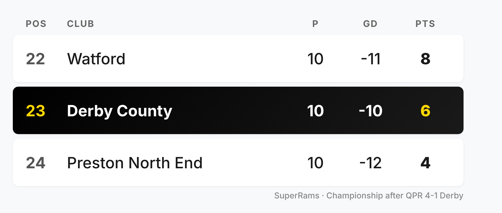

# Draft: QPR 4-1 Derby County

- **Published:** not yet - drafted against the `patreon-match-post` skill
  format. Lineup, subs, bookings, team stats and table now confirmed from
  Si's screenshots; a few gaps remain (see "Still open").
- **Fixture:** EFL Championship, Matchday 10, Loftus Road, Wednesday 14
  October 2026, KO 19:45 - Derby away.
- **Status:** WebFetch is blocked for every match-report domain, so result,
  scorers and quotes come from WebSearch summaries (Sky Sports, Yahoo,
  Derbyshire Live ratings, Sporting Life, ESPN). Lineup, bench, team stats
  and table are from Si's screenshots.

---

## Title field

```
QPR 4-1 Derby: Langås limps off, the defence goes with him, and a stoppage-time consolation that nobody asked for
```

## Public preview (above the paywall)

```
Seven league games without a win, and Loftus Road made sure it stayed that way.

QPR were 3-0 up by half-time, with Sondre Langås limping off after about ten minutes and the back line never really recovering.

Lars-Jørgen Salvesen got one back right at the death, which made the scoreline look nicer than the night actually was.

Derby are now second from bottom. Full breakdown for patrons below 👇
```

## Patrons-only body (below the paywall)

```
## The Match

EFL Championship, Matchday 10
QPR vs Derby County
Wednesday 14 October 2026, KO 19:45
Loftus Road, London


## Starting XI Rams

⚪ #31 - Josh Vickers
⚪ #23 - Joe Ward
⚪ #6 - Sondre Langås
⚪ #28 - Dion Sanderson
⚪ #26 - Ryan Hedges
⚪ #20 - Alex Mowatt
⚪ #4 - David Ozoh
⚪ #16 - Mohammed Fuseini
⚪ #8 - Bobby Clark
⚪ #11 - Sam Szmodics
⚪ #9 - Carlton Morris

(4-2-3-1)


## Subs

**10'** Langås ↓ · ↑ Nyambe
**45'** [SI - who came off] ↓ · ↑ Meister
**45'** [SI - who came off] ↓ · ↑ Travis
**62'** [SI - who came off] ↓ · ↑ Salvesen
**68'** [SI - who came off] ↓ · ↑ Bilbija

(Unused: O'Donnell, Brewster, Fraulo, Blackett-Taylor)


## The People, Not Just the Sheet

### Sondre Langås
Gone after roughly ten minutes, hurt blocking Rayan Kolli's effort after Paul Smyth's good work. Eustace says he's "in a bad way" and heading for a scan. With the defence already threadbare, losing your best centre-back that early was never going to end well, and it didn't. Fingers crossed for the scan.

### Ryan Nyambe
Dragged into the middle of the back four when Langås went off, because that's where the injury list has left us. Not his natural job, and the evening showed it, but he was only there because there was nobody else. [SI - add anything specific you saw]

### Josh Vickers
Derbyshire Live gave him a 4. A couple of decent stops kept it from being worse, but four goals is four goals. Hard to pin much on him behind that defence.

### Joe Ward, Ryan Hedges and Alex Mowatt
All three played the full 90 in a night where the fans' verdict was "too old, too slow". Ward got a 3 from Derbyshire Live, and the three of them are being named by name on Bluesky. [SI - your own view; also confirm Hedges was in the back four, as the lineup graphic has him]

### Sam Szmodics, David Ozoh and Carlton Morris
Three yellow cards for Derby and these were the three booked, all of them taken off before the end. Booked, beaten and hooked is not the evening any of them had in mind. [SI - add minutes of the bookings if you have them, and who came off for whom]

### Mohammed Fuseini
Beaten by Boy Kemper, who back-heeled the ball to Alfie Lloyd for QPR's opener on 18 minutes. Not all on him, but it's the kind of moment that sets a night's tone. [SI - add anything on his attacking play]

### Lars-Jørgen Salvesen
The one positive: on at 62', and a late goal to take him to two for the season. A consolation in the purest sense, but it was a goal, and he's now the sub we look to for end product. Not that it mattered.

### The manager
Eustace admitted the first goal was conceded poorly and says he's "confident we'll come through it". Seven games without a win and a growing injury list make that a brave line. [SI - add the rest of his post-match comments if you have them]


## Stats Snapshot

Goals: 18' Lloyd (QPR), 22' Madsen (pen, QPR), 45' Vale (QPR), 68' Smyth (QPR), 90+' Salvesen
Bookings: Carlton Morris, Sam Szmodics, David Ozoh (all yellow, minutes TBC); QPR had two
Attendance: [SI - not found]
Distance travelled: approximately 125 miles from Pride Park to Loftus Road (rough road estimate, not mapped)

Team stats (QPR v Derby): shots 10-11, on target 7-7, possession 56%-44%, corners 1-3, fouls 10-9, offsides 0-3.


## The Read

Four goals conceded, three of them before half-time, with the first player down hurt inside a quarter of an hour. That's the story, and it's mostly a squad-depth one.

The numbers make it odder than it felt. Derby had more shots (11 to 10), the same number on target (7 each), more passes and more corners, and still lost 4-1. QPR scored four of their seven on target, we scored one of ours. That's a night of defending badly and finishing worse, not one where we got outplayed on the stats sheet.

Derby are now 23rd, second from bottom, winless in seven, and the injury list is long enough that Nyambe is playing centre-back. Eustace has said the right things, but there's only so long you can talk about "difficult moments".

[SI - your own take on selection and shape, and whether Eustace's job is under pressure]


## Standings

Derby are now 23rd in the table with 6 points from 10 games and a goal difference of -10, above Preston North End and below Watford.




## In Their Words

> "So poor tonight it was shocking. No energy or quality. Defence porous, no attacking threat. Nothing whatsoever to get excited about, plus more injuries."
> - @beninchamonix.eurosky.social

> "One of the most embarrassing #dcfc performances in years. Arguably going back as far as Jewell. Injuries are no excuse, all teams have to cope with them. Too many players in this squad are old and slow. Ageing hacks like Mowatt, Hedges, Ward leave the team lacking athleticism. It's an absolute mess."
> - @derbycountyblog.bsky.social

> "Everything is wrong, no pace, no athleticism, no leadership, no passion. Coupled with a manager who looks like he's lost his confidence and faith. This was as bad as it gets. We are in deep trouble."
> - @mimij9.bsky.social


## Listen: Rams Review Podcast

[SI - link if there's an episode]


## Find More SuperRams

More Rams chat, every day, not just matchday:
🔵 Bluesky: https://bsky.app/profile/derbycounty.bsky.social
📘 Facebook: https://www.facebook.com/derbycountyrams
🐦 X: https://x.com/derbycounty


## What's Next

[SI - next fixture not found. Format: Team - Home/Away - date, KO (n days), per fixtur.es]
```

---

## Images

**Hero image:** use Si's Canva template, https://canva.link/zhp1gafamj0uzsa
(swap in QPR/Derby crests and "4-1").

**Standings - `assets/2026-10-14-qpr-4-1-derby/standings-22-24.png`**
Rebuilt from Si's table screenshot in the SuperRams look (black Derby row
with gold highlights, Inter, same dark/gold palette as the site). Shows
three rows only (22nd Watford, 23rd Derby, 24th Preston), because that's
all the screenshot contained and Derby are second from bottom. No club
crests, as I can't fetch them here. Columns match the Burnley post: P, GD, Pts.

## Still open (for Si)

1. **Who came off at 45', 45', 62', 68'.** The bench graphic shows who came on and when, but not who they replaced. The five who came off were Langås (replaced by Nyambe at 10'), Ozoh, Szmodics, Fuseini and Morris.
2. **Bookings minutes.** The lineup graphic shows yellows for Morris, Szmodics and Ozoh (matches the 3 in team stats), but not the minutes.
3. **Attendance.** Nothing found.
4. **Salvesen goal minute.** The bench graphic shows him on at 62' with a goal icon. Sources put the goal at 90+ (one says 90+10). Confirm the exact minute.
5. **Next fixture** and days away.
6. **Podcast link**, hero image, and your own take for The Read and the player sections marked `[SI]`.
7. **Hedges in the back four?** The lineup graphic has him in the defensive line.
8. **Score check:** Hayters and its Yahoo repost say 4-0, everything else says 4-1. I've gone with 4-1.
9. **Squad numbers** from the bench graphic: Blackett-Taylor #33 (resolves the tracker conflict), Fraulo #29, Brewster #10, O'Donnell #12 (GK). Salvesen #15, Meister #19 and Travis #27 are from the tracker, and Bilbija and Nyambe are still TBC.
10. **Player tracker** not updated. Its coverage note says MD1, MD3 and MD5-MD8 are missing, so worth backfilling first.

## Sources

- [QPR 4-1 Derby: Rangers thump four past struggling Rams (Sky Sports)](https://www.skysports.com/football/queens-park-rangers-vs-derby-county/7909744856851560232)
- [QPR vs. Derby (ESPN)](https://www.espn.com/soccer/match/_/gameId/401880221)
- [QPR 4-1 Derby - the fans' verdict (Yahoo Sports)](https://sports.yahoo.com/articles/qpr-4-1-derby-fans-103020066.html)
- [Derby County player ratings vs QPR (via News Beep)](https://www.newsbeep.com/771055/)
- [QPR v Derby player ratings (West London Sport)](https://www.westlondonsport.com/qpr/football-qpr-thump-derby-how-we-rated-the-players)
- [Eustace fearful Derby defender is set for spell out as injury crisis worsens (Hayters)](https://hayters.com/eustace-fearful-derby-defender-is-set-for-spell-out-as-injury-crisis-worsens/)
- [QPR 4-1 Derby (The Pride of West London)](https://tobyyoung.substack.com/p/qpr-4-1-derby)
- [Sporting Life commentary](https://www.sportinglife.com/football/live/234290/queens-park-rangers-vs-derby-county/commentary)
