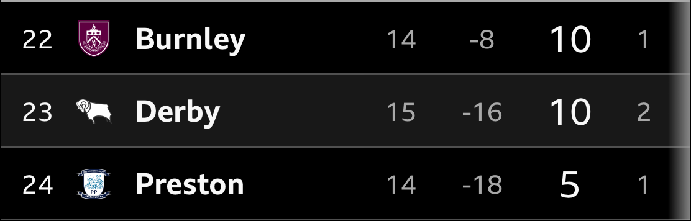

# Draft: Derby County 3-1 Bolton Wanderers

- **Published:** not yet — drafted against the `patreon-match-post` skill format.
- **Fixture:** EFL Championship, Pride Park, Friday 6 November 2026, KO 20:00 — Derby home.
- **Status:** Lineup, goals/minutes, bench, stats, attendance and table are from
  Si's screenshots (Google match page). Story detail (Eustace quotes, Robinson
  header, Fuseini assist, Duffy debut) is from search summaries only — every
  match-report domain is blocked in this environment.

## Still open before publishing

- **Resolved from BBC screenshots:** sub pairings and minutes (Travis→Mowatt
  73', Fuseini→Fraulo 93', Morris→Salvesen 93'; Google showed 72' / 90+2' —
  BBC used), Brewster's yellow at 90+4', GD -16, Travis is captain.
- **Assists confirmed** (Google match page): Fuseini for Nyambe 46', Morris for Robinson 49'.
- **Next fixture** supplied by Si (Southampton away, 21 Nov, 12:30); fixtur.es couldn't be checked from here.
- **Fan quotes** — three Bluesky quotes added from Si's screenshots (a fourth, @derbydaniel.bsky.social, "big amount of relief… can't be a false dawn again", is spare).
- Bobby Clark "free-kick transformed the game" and Sanderson/Ozoh "lost ground
  on Bolton's goal" are from a single ratings write-up (Newsbeep, via search) —
  checked against the match, not a first-hand view.

---

## Title field

```
Derby 3-1 Bolton: the first win in 11 games, and we did it with 30% of the ball and a debutant at the back
```

## Public preview (above the paywall)

```
Eleven games without a win. A first home victory of the season. And somehow it came with Bolton having 70% of the ball.

Behind at half-time, Derby were level four minutes after the restart and in front three minutes after that.

Rhian Brewster made sure of it in the fourth minute of stoppage time.

Full breakdown for patrons below 👇
```

## Patrons-only body (below the paywall)

```
## The Match

EFL Championship
Derby County vs Bolton Wanderers
Friday 6 November 2026, KO 20:00
Pride Park, Derby


## Starting XI Rams

⚪ #1 — Jacob Widell Zetterström
⚪ #24 — Ryan Nyambe
⚪ #25 — Shane Duffy
⚪ #28 — Dion Sanderson
⚪ #14 — Jack Robinson
⚪ #27 — Lewis Travis (c)
⚪ #4 — David Ozoh
⚪ #16 — Mohammed Fuseini
⚪ #8 — Bobby Clark
⚪ #10 — Rhian Brewster
⚪ #9 — Carlton Morris

(4-2-3-1)


## Subs

**73'** Travis ↓ · ↑ Mowatt
**93'** Fuseini ↓ · ↑ Fraulo
**93'** Morris ↓ · ↑ Salvesen


## The People, Not Just the Sheet

### Ryan Nyambe
Leveller at 46' — barely into the second half, and the goal that changed the mood of the whole ground. Set up by Fuseini, finished from close range. Reports are calling it his first professional goal, which would make a Friday night in Derby a decent place to pick one up.

### Jack Robinson
49' header from a Carlton Morris assist, three minutes after Nyambe, and Derby go from losing to winning inside five minutes of the restart. First goal for the club, and a recent signing already earning his keep.

### Rhian Brewster
90+4' — the goal that took it from nervy to done. Booked at 90+4' — the same minute he scored — and a reminder that he's at his most useful when there's space to run into.

### Shane Duffy
Debut after a fortnight on a short-term deal, started and was credited with a key block. Experience is what Eustace said had been missing all season and here it was, in a back four that had to deal with Bolton having the ball for 70% of the night.

### Mohammed Fuseini
Assist for Nyambe's equaliser, then off for Fraulo in stoppage time. Did the job of the night's most important pass without needing to be the headline.

### Bobby Clark
One report credits his free-kick with turning the game after a quiet first half. We'll take that, because he'd been quiet.

### Dion Sanderson and David Ozoh
Not the best moments on Bolton's goal — Larrazabal's cross and Rodrigues' finish in the 42nd minute came with both of them a yard behind where they needed to be. Neither of them was bad enough for it to matter in the end, which is the nicest thing we can say.

### Carlton Morris
Led the line and set up Robinson's header for the go-ahead goal before making way for Salvesen in stoppage time. More of that, please.


## Stats Snapshot

Goals: 46' Ryan Nyambe, 49' Jack Robinson, 90+4' Rhian Brewster (Bolton: 42' Rúben Rodrigues)
Bookings: (90+4') Rhian Brewster, yellow
Attendance: 27,536
```

(Possession: Derby 30% – 70% Bolton. Shots 7 – 11, on target 5 – 7. Passes 222 – 553. Derby scored three from five on target.)

```
## The Read

Seven shots, three goals. Bolton had everything except the result.

You'll hear the stats and think we got lucky. Seventy per cent possession for the opposition, 553 passes to our 222. That's not a performance, that's a smash-and-grab.

But a team that scores three from five on target, finds two goals in the first five minutes of a half, and sees the game out is doing something right, even if it isn't pretty.

Eustace said the character of the group showed, and "we can't get carried away but we can be proud". He's right on both counts. Ten points from 15 games, level with Burnley and four off safety, is still a relegation position.

But it's a better place to be than 24 hours ago.


## Standings

Derby are now 23rd in the table with 10 points from 15 games and a goal difference of -16, above Preston North End and below Burnley.




## In Their Words

> "I expected to see another 4 goals tonight, I did not expect 3 of them to be in our favour. What a night, regardless of the wider situation, let's enjoy this tonight. Up the Rams"
> — @gimjee94.bsky.social

> "Let's enjoy tonight and not get bogged down in the bigger picture stuff. I don't think tonight changes my opinion and I'll be ready to throw water all over Radio Derby's open-top bus parade tomorrow. But for tonight, a big 3 points."
> — @iamzavagno.bsky.social

> "There is more to the problems at Derby than a lengthy injury list but what a huge difference experienced defenders, in something approaching their correct positions, makes. Duffy organising the back line with authority is something we have desperately missed."
> — @apancisi.bsky.social


## Find More SuperRams

More Rams chat, every day, not just matchday:
🔵 Bluesky: https://bsky.app/profile/derbycounty.bsky.social
📘 Facebook: https://www.facebook.com/derbycountyrams
🐦 X: https://x.com/derbycounty


## What's Next

Southampton — Away — Saturday 21 November 2026, KO 12:30 (15 days) — per [fixtur.es](https://fixtur.es/en/team/derby-county)
```

---

## Images

- **Hero:** `assets/2026-11-06-derby-3-1-bolton/hero-derby-3-1-bolton.jpg` — Si's Canva design (gold/blue split, real crests, "3 - 1"). Use at the top, above The Match.
- **Standings:** `assets/2026-11-06-derby-3-1-bolton/standings-22-24.png` — cropped from the BBC table: Burnley (22nd), Derby (23rd), Preston (24th).
