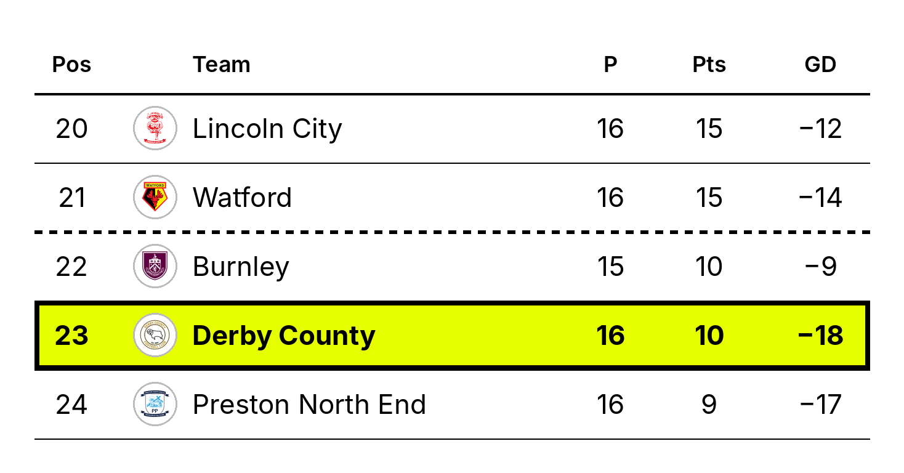
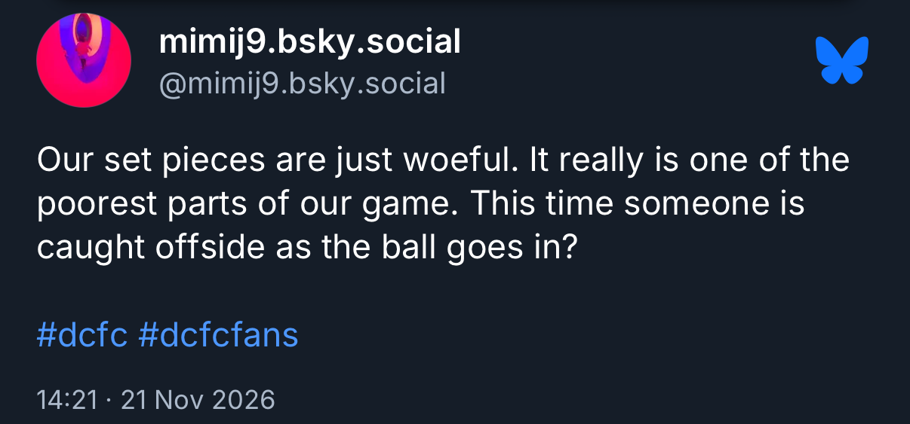

# Draft: Southampton 2-0 Derby County

- **Published:** not yet, drafted against the `patreon-match-post` skill format.
- **Fixture:** EFL Championship, Matchday 16, St Mary's, Saturday 21 November 2026, KO 12:30 - Derby away.
- **Status:** ready to publish. XI with squad numbers, formation, subs, bookings, attendance, key moments, the table and the Wolves kick-off are checked against ESPN's match data (fetched 22 Nov). See "Still open" at the bottom for the two things that could still change.

---

## Title field

```
Southampton 2-0 Derby: 57 minutes of looking fine, then the usual
```

## Public preview (above the paywall)

```
For nearly an hour at St Mary's, Derby were doing a decent job of keeping the Championship's best home side quiet.

Then Cyle Larin, back from a hamstring injury, scored on 57 minutes, because of course he did.

We threw everything forward late on, won a corner in stoppage time, and Divin Mubama finished us off on the break a minute later.

Southampton are now 18 unbeaten at home. We're still 23rd.

Full breakdown for patrons below 👇
```

## Patrons-only body (below the paywall)

```
## The Match

EFL Championship, Matchday 16
Southampton vs Derby County
Saturday 21 November 2026, KO 12:30
St Mary's Stadium, Southampton


## Starting XI Rams

⚪ #1 — Jacob Widell Zetterström
⚪ #24 — Ryan Nyambe
⚪ #28 — Dion Sanderson
⚪ #25 — Shane Duffy
⚪ #14 — Jack Robinson
⚪ #4 — David Ozoh
⚪ #20 — Alex Mowatt
⚪ #16 — Mohammed Fuseini
⚪ #8 — Bobby Clark
⚪ #10 — Rhian Brewster
⚪ #9 — Carlton Morris (c)

(4-2-3-1)


## Subs

**61'** Fuseini ↓ · ↑ Meister
**77'** Clark ↓ · ↑ Bilbija
**77'** Ozoh ↓ · ↑ Fraulo
**77'** Morris ↓ · ↑ Salvesen
**83'** Meister ↓ (injured) · ↑ Blackett-Taylor


## The People, Not Just the Sheet

### Alex Mowatt
Back in the side in place of Lewis Travis, and part of a midfield that kept Southampton to one first-half shot on target. For a side that's been shipping goals all season, that's a half we'd have bitten your hand off for. He also teed up Fuseini for our best effort of the second half, saved by Peretz on 53'.

### David Ozoh
Booked on 49' for what the live text calls a "bad foul", then hooked on 77'. Our only booking of the afternoon, and four minutes into the second half isn't the time to be giving the referee ideas.

### Henrik Meister
On for Fuseini on 61', off again on 83' with an injury. Twenty-two minutes. After the Birmingham collapse and the Bramall Lane knock, it's now three scares in a handful of games, and at this point we'd quite like him wrapped in cotton wool before Wolves.

### Jacob Zetterström
Kept Finn Azaz out three times, on 17', 57' and 65'. The 57' one is the painful one: Larin scored from close range in the same minute. Nothing he could do about Mubama's, which came on the break seconds after we'd had a corner of our own.

### Carlton Morris
Captain again, and had our best chance of the first half, a 44' shot from Bobby Clark's pass that Peretz saved. Off on 77' as we chased it, while Larin marked his first game back with his eighth of the season for them.


## Stats Snapshot

Goals: none for Derby (Southampton: 57' Larin, 90+5' Mubama)
Bookings: (49') David Ozoh, yellow
Attendance: 28,381. Away fans figure not published.
Distance travelled: approximately 165 miles from Pride Park to St Mary's


## The Read

Losing at St Mary's isn't a scandal. They're unbeaten in 18 at home and we're not exactly the side to end that.

What hurts is the pattern. We hang in, we look organised, then one moment and it's gone. That's the difference between 23rd and 20th, and we've not fixed it in 16 games.

Ten points from sixteen. Wolves away on Tuesday doesn't get any easier, and with Meister's fitness a question mark again, Eustace is running short of answers up top.


## Standings

Derby are now 23rd in the table with 10 points from 16 games and a goal difference of -18, above Preston North End and below Burnley.



Five points from safety, and Burnley have a game in hand.


## In Their Words



> "Our set pieces are just woeful. It really is one of the poorest parts of our game. This time someone is caught offside as the ball goes in?"
> — [@mimij9.bsky.social](https://bsky.app/profile/mimij9.bsky.social/post/3n2tcduemt22p)


> "Routine away defeat for a relegation candidate at a promotion chaser, basically. #dcfc never laid a glove on Southampton and deserved nothing from the game. Not much else to say about it, really."
> — [@derbycountyblog.bsky.social](https://bsky.app/profile/derbycountyblog.bsky.social/post/3n2tcndwnhc2c)


> "It was an honest, hard working performance from Derby, which has not always been the case this year. However, Derby barely threatened and never looked like scoring. If you don't score you don't win and usually don't even draw."
> — [@apancisi.bsky.social](https://bsky.app/profile/apancisi.bsky.social/post/3n2tft4i2ms2r)


## Find More SuperRams

More Rams chat, every day, not just matchday:
🔵 Bluesky: https://bsky.app/profile/derbycounty.bsky.social
📘 Facebook: https://www.facebook.com/derbycountyrams
🐦 X: https://x.com/derbycounty


## What's Next

Wolverhampton Wanderers — Away — Tuesday 24 November 2026, KO 20:00 (3 days), Molineux
```

---

## Images

- **Hero image:** generated with `tools/cover_image.js`, saved as `assets/2026-11-21-southampton-2-0-derby/hero-southampton-2-0-derby.jpg`.
- **Standings image:** crop of the table around Derby, to `assets/2026-11-21-southampton-2-0-derby/standings.png`.

## Still open

- **Burnley v Blackburn kicks off at 12:00 today (Sun 22 Nov).** Burnley stay 22nd whatever happens (GD -9 vs our -18), but if they've played by the time this goes out, regenerate `standings.png` and drop "and Burnley have a game in hand".
- **Mowatt and Meister notes** are from ESPN's live text, not from watching. Add anything you saw yourself.
- **Eustace / Sanderson quotes:** dcfc.co.uk post-match pieces are video only, so no quotes used.
- **Duffy offside on 90+1'** is logged by ESPN; no disallowed goal is recorded, so mimij9's "caught offside as the ball goes in" stays as her take only.
- **Player tracker:** last updated 10 October. Not updated by this draft.

## Sources

- [Southampton FC match report](https://www.southamptonfc.com/en/news/article/report-larin-strikes-on-return-as-saints-defeat-derby)
- [Sky Sports report](https://www.skysports.com/football/news/13611552/southampton-2-0-derby-cyle-larin-and-divin-mubama-strike-in-saints-win)
- [Sky Sports live commentary](https://www.skysports.com/football/southampton-vs-derby/live/560685)
- [Derby team news (dcfc.co.uk)](https://www.dcfc.co.uk/news/2026/11/team-news-southampton-a)
- [dave.sport confirmed line-ups](https://dave.sport/news/southampton-vs-derby-confirmed-line-ups/)
- [dave.sport result](https://dave.sport/news/southampton-vs-derby-result-november-2026/)
- [Tufutbolero (bookings)](https://www.tufutbolero.com/en/news/southampton-2-0-derby-larin-and-mubama-score-at-st-mary-s-5d492e)
- [Yahoo Sports](https://uk.sports.yahoo.com/news/larin-scores-injury-return-saints-142800684.html)
- [Squawka preview (pre-match table)](https://squawka.com/en/news/previews/southampton-vs-derby-county-predictions-today-21-11-2026)
- [ESPN Derby fixtures](https://www.espn.com/soccer/team/fixtures/_/id/374/derby-county)
- [ESPN match data: Southampton 2-0 Derby](https://www.espn.com/soccer/match/_/gameId/401880153)
- [Post-match: Dion Sanderson (dcfc.co.uk)](https://www.dcfc.co.uk/news/2026/11/post-match-dion-sanderson-southampton-a)
