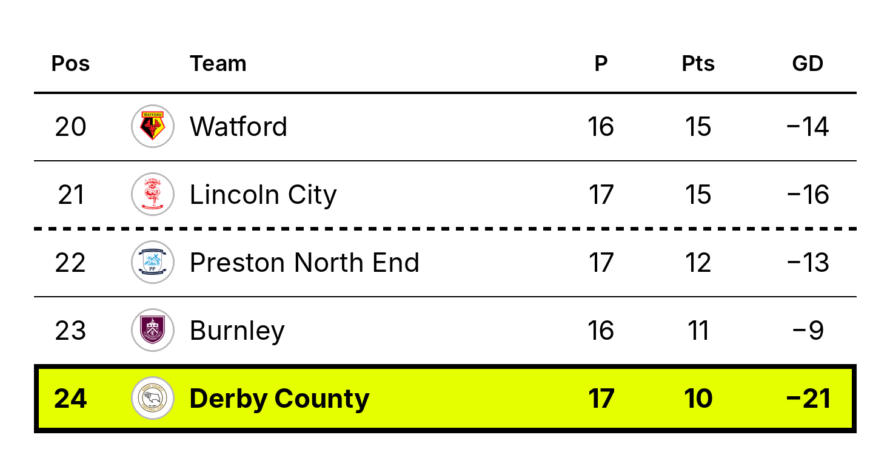

# Draft: Wolves 3-0 Derby County

- **Published:** not yet, drafted against the `patreon-match-post` skill format.
- **Fixture:** EFL Championship, Matchday 17, Molineux, Tuesday 24 November 2026, KO 20:00 - Derby away.
- **Status:** XI with squad numbers, formation, subs, bookings, goals, attendance, match stats, the table and the Watford kick-off are checked against ESPN's match data (fetched 25 Nov). Eustace quotes and two player details are from search summaries only. No fan quotes (Bluesky unreachable from this environment). See "Still open".

---

## Title field

```
Wolves 3-0 Derby: one shot on target, 39 against, and now we're bottom
```

## Public preview (above the paywall)

```
Carlton Morris had a clear chance inside two minutes at Molineux and Nasser Djiga took it off his toes.

That was more or less Derby's evening in attack: six shots, one on target.

Wolves had 39 shots, Adam Armstrong scored twice and Mateus Mané once, and Wolves went second.

Preston won 4-0 at Cardiff on the same night, so Derby are now bottom of the Championship.

Full breakdown for patrons below 👇
```

## Patrons-only body (below the paywall)

```
## The Match

EFL Championship, Matchday 17
Wolverhampton Wanderers vs Derby County
Tuesday 24 November 2026, KO 20:00
Molineux, Wolverhampton


## Starting XI Rams

⚪ #1 — Jacob Widell Zetterström
⚪ #28 — Dion Sanderson
⚪ #25 — Shane Duffy
⚪ #5 — Matt Clarke
⚪ #24 — Ryan Nyambe
⚪ #13 — Filip Bilbija
⚪ #4 — David Ozoh
⚪ #20 — Alex Mowatt
⚪ #10 — Rhian Brewster
⚪ #16 — Mohammed Fuseini
⚪ #9 — Carlton Morris (c)

(3-5-2)


## Subs

**58'** Bilbija ↓ · ↑ Clark
**58'** Morris ↓ · ↑ Salvesen
**80'** Duffy ↓ · ↑ Johnston
**81'** Mowatt ↓ · ↑ Fraulo
**81'** Fuseini ↓ · ↑ Blackett-Taylor


## The People, Not Just the Sheet

### Jacob Zetterström
Six saves, three conceded, and not one of them is on him. Wolves had 39 shots and nine on target, which means he was basically doing a shooting drill with 28,970 people watching. Armstrong's second was a volley into the top corner, the kind you applaud quietly and then go and sit in the car. When your keeper is the busiest man in the team every single week, the problem is in front of him.

### Carlton Morris
Had Derby's best chance of the night inside two minutes and Djiga got a tackle in. Still finished with three of our six shots, which tells you everything about the other ten. Hooked on 58' for Salvesen. The captain can't do it on his own, and on nights like this it looks like he's been asked to.

### Filip Bilbija
First league start after a run of sub appearances, and got denied from six yards. Off on 58' with Clark coming on. Not the night he'd have wanted to finally get the shirt, but one start in a side that managed one shot on target isn't enough to judge him on.

### Ryan Nyambe
Six tackles from right wing-back, the most of anyone in a Derby shirt. When your wing-back is the busiest outfield player on the pitch, you know which way the game was going. We had 35% of the ball and won one corner to their eleven.

### Matt Clarke and Shane Duffy
Both back in from the start, which is the closest thing to good news in this report. Duffy made way for Johnston on 80', just after the second and third went in two minutes apart. Eustace is banking on these two, plus Jack Robinson, getting fit and staying fit to fix this. One clean sheet would be a start.

### Mohammed Fuseini
Had a couple of the clearer early openings and didn't make either count. Off on 81' for Blackett-Taylor. If we're going to stay up, early chances have to become early goals, because we're not getting late ones.


## Stats Snapshot

Goals: none for Derby (Wolves: 29' Armstrong, 74' Mané, 76' Armstrong)
Bookings: none for Derby
Attendance: 28,970. Away fans figure not published.
Distance travelled: approximately 45 miles from Pride Park to Molineux


## The Read

Six shots, one on target, and a second half Eustace himself summed up as "we didn't come out at all really". One win in 13 league games. That's not a blip, that's the season.

Wolves are second and losing there isn't the scandal. Losing there like that is. Eustace said we missed "two or three chances" and you "can't afford to let them off" against a top team, which is true, but we didn't exactly have many to miss.

The scary number is goal difference. We're on -21, five worse than anyone else in the bottom five. Level on points won't be enough.

The good news, if you squint, is that the bottom is tight. Preston were bottom on Saturday and are now two points clear after one win. One win flips it back. Which makes Saturday the whole thing: Watford at home, sitting 20th and five points ahead of us, and no "tough fixture" excuse this time.


## Standings

Derby are now 24th in the table with 10 points from 17 games and a goal difference of -21, below Burnley and with nobody beneath us. Burnley and Watford both have a game in hand.




## In Their Words

Patrons, over to you. Watford at home on Saturday: after one shot on target at Molineux, who comes in, and who has to sit down? Tell us below 👇


## Eustace Said

> "Then we tired in the second half and we didn't come out at all really. We looked leggy and we continued in that rhythm."
> — John Eustace

> "We missed two or three chances which we didn't take and against a top team you can't afford to let them off."
> — John Eustace


## Find More SuperRams

More Rams chat, every day, not just matchday:
🔵 Bluesky: https://bsky.app/profile/derbycounty.bsky.social
📘 Facebook: https://www.facebook.com/derbycountyrams
🐦 X: https://x.com/derbycounty


## What's Next

Watford — Home — Saturday 28 November 2026, KO 15:00 (4 days) — per fixtur.es
```

---

## Images

- **Hero image:** generated with `tools/cover_image.js`, saved as `assets/2026-11-24-wolves-3-0-derby/hero-wolves-3-0-derby.jpg`. Wolves overridden to black (`--home-colour "#231F20"`) because their gold clashes with Derby's.
- **Standings image:** generated with `tools/standings_image.py`, saved as `assets/2026-11-24-wolves-3-0-derby/standings.png`.

## Still open

- **No fan quotes.** Bluesky (and the fan-feed Worker, no `FAN_FEED_URL`) isn't reachable from this environment, so In Their Words is a comment prompt. Swap in 2-3 quotes if you've got some.
- **Eustace quotes** come from search summaries of the post-match coverage (AOL/BBC syndication), not a fetched page.
- **Morris's early chance blocked by Djiga, Bilbija denied from six yards, Nyambe's six tackles** are from search summaries (Sky Sports, Yahoo ratings, PlayerStats), not ESPN's data.
- **Burnley and Watford have a game in hand.** If either plays before this goes out, regenerate `standings.png`.
- **Player tracker:** lives in Google Drive, not updated by this draft.

## Sources

- [ESPN match summary API (event 401880141)](https://site.api.espn.com/apis/site/v2/sports/soccer/eng.2/summary?event=401880141): lineups, numbers, formation, subs, goals, bookings, attendance, stats
- [ESPN Championship standings API](https://site.api.espn.com/apis/v2/sports/soccer/eng.2/standings)
- [ESPN Derby schedule API](https://site.api.espn.com/apis/site/v2/sports/soccer/eng.2/teams/374/schedule?fixture=true)
- [Wolverhampton Wanderers 3-0 Derby County (Sky Sports)](https://www.skysports.com/football/news/13610525/wolverhampton-wanderers-3-0-derby-county-adam-armstrong-nets-twice-in-wolves-win)
- [Derby County player ratings vs Wolves (Yahoo Sports)](https://uk.sports.yahoo.com/news/derby-county-player-ratings-vs-220100047.html)
- [Wolves 3-0 Derby (PlayerStats)](https://playerstats.football/fixture/wolverhampton-wanderers/derby-county/2026-11-24)
- [Eustace confident Derby can escape relegation peril (AOL)](https://www.aol.com/articles/eustace-confident-derby-escape-relegation-233435000.html)
- [Cardiff 0-4 Preston (ESPN)](https://africa.espn.com/soccer/match/_/gameId/401880147/preston-north-end-cardiff-city)
